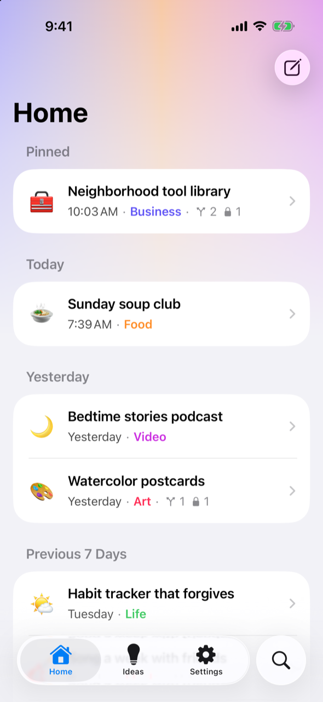
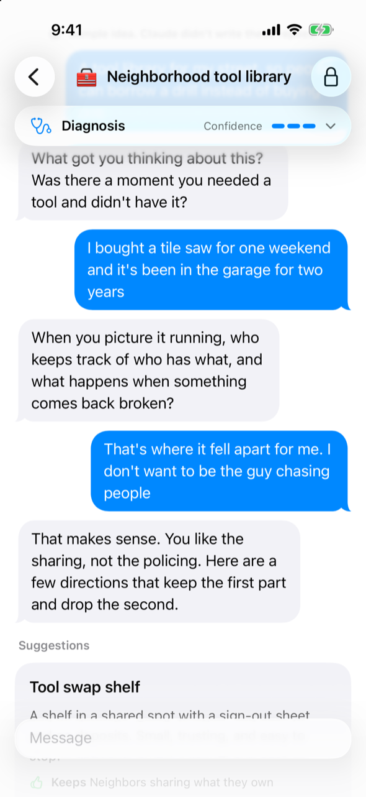
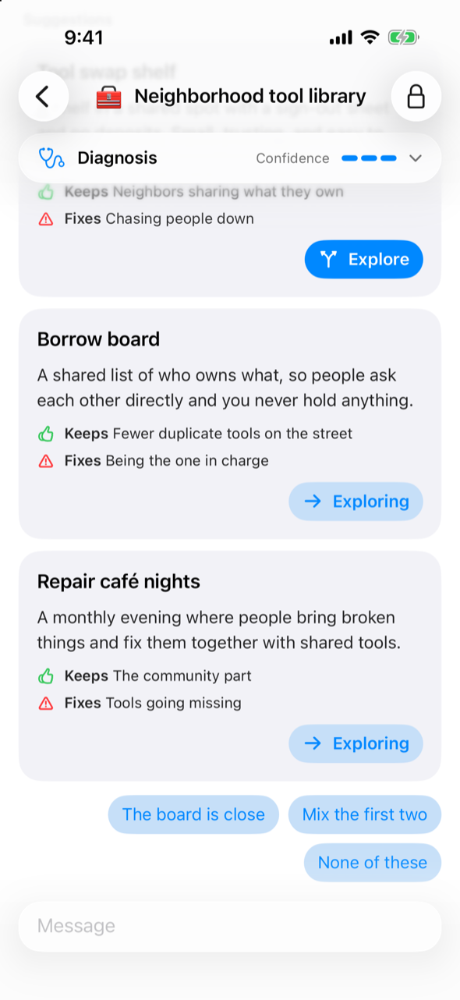
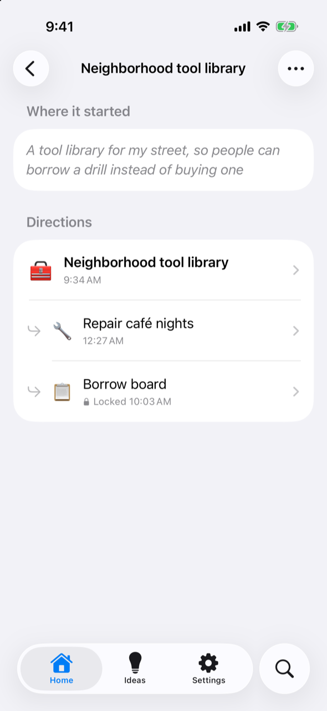
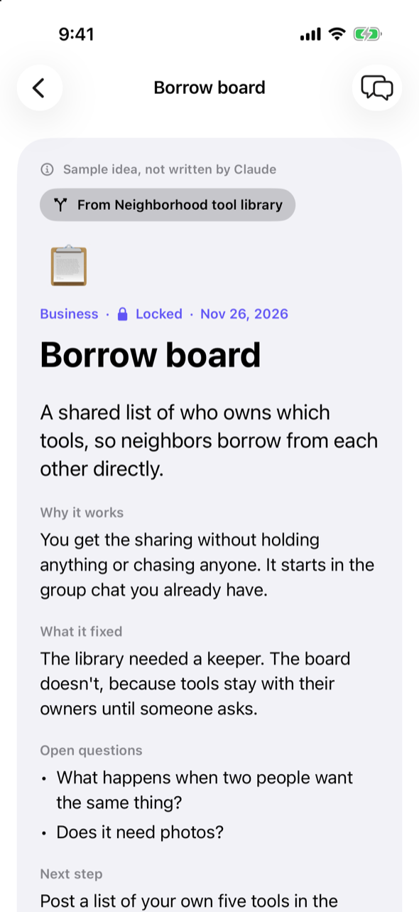
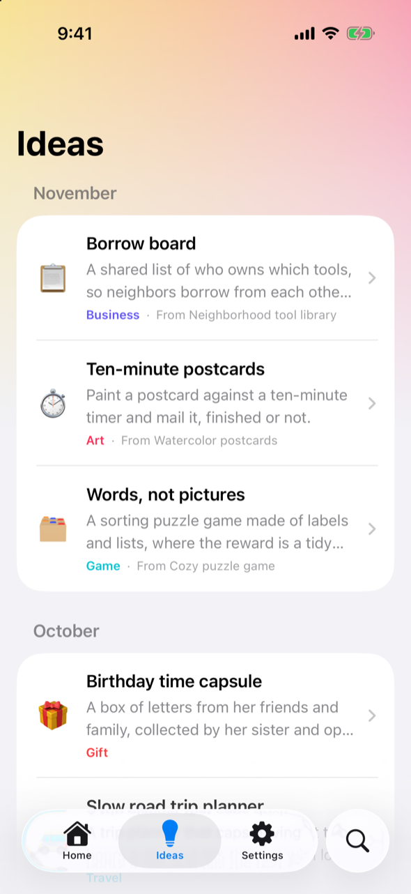
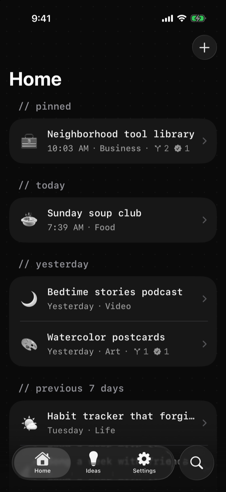
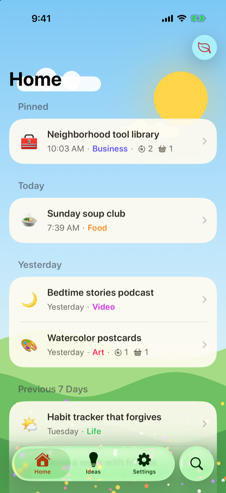

# Rubber Duck

A native iOS app for reworking ideas, named after rubber-duck debugging: explain your idea out loud and it starts to make sense. Bring an idea that isn't quite there, or one you've gone off. Claude asks questions until it understands what you liked and what broke, then offers alternatives that keep the good part and fix the bad one. Pick one to go deeper, and lock it in as an idea card when you're happy with it.

SwiftUI on iOS 26 with Liquid Glass, SwiftData for storage, and the Claude API (`claude-opus-5-5`) for the conversation.

<p align="center">
  
  
  
</p>
<p align="center">
  
  
  
</p>
<p align="center">
  
  
</p>

<p align="center"><sub>The screenshots use the app's built-in sample ideas (see Sample data below); Claude didn't write the conversations shown. Themes: System (top rows), Mono and Farm.</sub></p>

## How it works

- **Ideas branch.** Exploring a suggestion creates a child idea, and continuing a locked idea creates a child of it. An idea together with everything that branched from it is a journey.
- **Tabs.** Home lists journeys (two-line rows: emoji and title, then last activity, category, and the number of directions and locked ideas as small icons), pinned first, then by last activity in Today, Yesterday, Previous 7 Days and so on, like Notes. In the System theme a soft glow sits behind the large title and fades as you scroll, like Health's Summary: on Home it takes the colors of your latest ideas, on Ideas it's warm yellow, orange and pink. A journey with branches opens a map (where it started, then each direction); one without opens straight into its conversation. Ideas lists the ideas you've locked in, by month. Settings is a tab, and Search sits at the trailing end, as iOS 26 places it; before you type, it lists your categories to browse. The tab bar shrinks as you scroll and hides inside a conversation. While it's small, its tab is the label color instead of blue; iOS doesn't tell apps when the bar minimizes, so `TabBarState` follows the scroll (small as soon as you scroll down, full again at the top, as iOS 26 behaves).
- **Icons and categories.** Once an idea has a name, a separate small request (`Prompts.lookSystem`, low effort) picks an emoji and a category. The emoji leads the idea's row (and sits by the title in a conversation and on its card). Each category has one color, so ideas in the same category always match: fixed for the starting categories, and picked from the name for ones Claude makes (`IdeaCategories.color(for:)`). It tints category labels and the glow on Home. It chooses from the starting categories in `IdeaCategories.defaults` plus any it has made before, and makes a new one only when none fits; answers that differ only in case or a plural reuse the existing spelling. Keeping it out of the conversation leaves the replayed history and the prompt cache untouched. Ideas without one (including those from before icons) show 💡 as Uncategorized and get theirs the next time you reply in them. Mono shows the emoji in grayscale. Emoji on a colored circle, the emoji in the title, a color dot and no icon were tried and dropped.
- **Pin and delete.** Swipe right to pin and left to delete, or long-press for both; a journey's map has them in its ⋯ menu. Deleting an idea takes every direction under it, so it asks first when there are any. Deletes reach all your devices through iCloud.
- **Nothing is saved until you send.** A new idea is only a draft page until its first message; leaving without sending discards it.
- **Diagnosis.** Every reply rewrites what you liked, what broke, what a better version needs, and how confident Claude is. It's pinned above the conversation.
- **Structured replies.** Each turn comes back as JSON (`AI/Schemas.swift`): a question, a "ready" note, or a set of ideas, plus quick replies, a title and the diagnosis. Locking makes a separate request that writes the card.
- **Ideas in two steps.** When the coach has heard enough it replies "ready" (a one-line playback). The app then sends a hidden go-ahead and shows "Building suggestions" while the ideas are written at higher effort. Tapping Suggest Ideas skips straight to the second step.
- **History replay.** Claude's reply blocks are stored exactly as returned and sent back unchanged, which keeps its earlier reasoning valid and the prompt cache warm. Don't edit `Prompts.coachSystem` mid-conversation in code that reuses old conversations; if you do, the API drops the stale reasoning rather than failing.
- **iCloud sync, no login.** SwiftData syncs ideas and conversations to the private iCloud database (container `iCloud.com.raouh.ideas`) of whoever is signed in on the device, so they reach your other devices and survive a lost phone. If iCloud isn't available the same store works on the device only. The API key (Keychain, this device only) and theme stay per device. Sync needs a paid Apple developer team (see Running it).
- **Themes.** System (standard iOS: system colors and font, blue tint, follows Light and Dark Mode; the default), Mono (black and white, coding font, git vocabulary) and Farm (sky, hills, flowers, rounded font, garden vocabulary). The theme is stored per device. System tints controls with the label color, as iOS 26 does, and keeps blue for your bubbles and the main actions; delete is always red. Light or dark is set on the window in `RootView`, because SwiftUI's `preferredColorScheme(nil)` doesn't undo an earlier forced mode.

The app was first called Ideas. The bundle ID (`com.raouh.ideas`), the iCloud container (`iCloud.com.raouh.ideas`) and the Xcode target (`IdeaApp`) keep the old name on purpose: changing the bundle ID or container would make iOS treat it as a new app and leave existing ideas behind.

## Running it

1. Open `IdeaApp.xcodeproj` in Xcode 26.5.
2. Xcode needs the iOS 26.5 platform: Xcode → Settings → Components. Until it's installed, Xcode won't list any run destinations. The command-line build below works without it, as long as asset catalogs are allowed to use the installed iOS 26.4 runtime (set once on this Mac with `xcrun simctl runtime match set iphoneos26.5 23E244`; undo with `xcrun simctl runtime match set iphoneos26.5 --default`).
3. Choose your team under Signing & Capabilities. Xcode then registers the app ID and the iCloud container `iCloud.com.raouh.ideas` in your developer account (containers can't be deleted or renamed later). Each device needs to be signed in to iCloud.
   Before the first TestFlight or App Store build, deploy the CloudKit schema to Production in the CloudKit Console; those builds use the Production environment.
4. In the app, open Settings and paste a Claude API key. It's kept in the device Keychain. Without a key the app asks for one; there's no fake mode in the app itself.

Command-line build for the simulator:

```bash
xcodebuild -project IdeaApp.xcodeproj -target IdeaApp -sdk iphonesimulator -arch arm64 -configuration Debug SYMROOT="$PWD/build/Products" OBJROOT="$PWD/build/Intermediates" build
```

### On an iPhone with a free Apple account

A free (Personal Team) account can install the app straight from this Mac, without iCloud: such builds are signed with `IdeaApp-Free.entitlements` (no iCloud or push), so ideas stay on the phone. CloudKit stops the app on launch (it doesn't throw) when asked for a container the build isn't allowed, so `IdeaApp.canUseICloud` reads the provisioning profile first and opens the on-device store directly. The install expires after 7 days; rebuilding and installing again keeps the ideas. Developer Mode must be on (Settings → Privacy & Security), and the first launch needs the developer trusted in Settings → General → VPN & Device Management.

```bash
xcodebuild -project IdeaApp.xcodeproj -scheme IdeaApp -configuration Release -destination 'platform=iOS,id=<device UDID>' -derivedDataPath "$PWD/build/Device" -allowProvisioningUpdates -allowProvisioningDeviceRegistration DEVELOPMENT_TEAM=<personal team ID> CODE_SIGN_ENTITLEMENTS=IdeaApp-Free.entitlements build
```

```bash
xcrun devicectl device install app --device <device identifier> build/Device/Build/Products/Release-iphoneos/IdeaApp.app
```

`xcrun devicectl list devices` shows the device identifier, and `xcrun devicectl device info details --device <identifier>` its UDID. With a paid account, drop the `CODE_SIGN_ENTITLEMENTS` override to get iCloud sync back.

### Debug scenarios

Debug builds can drive themselves through a scripted session with `DemoCoach`, which returns canned replies with no API calls. It's for checking screens, not the conversation; a "not Claude" label shows while it's on. A scenario runs in a throwaway in-memory store, so real and synced ideas are never touched. To get canned replies without a scenario, launch with `-DemoReplies YES`.

```bash
xcrun simctl launch booted com.raouh.ideas -DebugScenario ideas -DebugTheme farm
```

Stops: `empty`, `first`, `questions`, `ideas`, `branch`, `locked`, and `gallery` (sample ideas with icons, no conversation). Use `-DebugTheme`, not `-themeID`: a launch argument overrides the saved setting for the whole run, so you couldn't switch themes in Settings.

### Sample data

Debug builds can add 15 mock journeys (with directions, locked ideas, icons and categories, spread from today back to last December) to the real store, to see the app full:

```bash
xcrun simctl launch booted com.raouh.ideas -SeedSampleData YES
```

It runs once; it does nothing if samples are already there. They're marked `isSample`, and their conversations and cards say Claude didn't write them. `-RemoveSampleData YES` deletes them and nothing else. Mind iCloud: once sync is on, samples sync like any other idea.

## Layout

```text
IdeaApp/
  IdeaApp.swift           App entry, SwiftData container
  Models/                 Idea (the tree, diagnosis, card, icon), IdeaMessage, IdeaLook (colors and categories)
  AI/                     ClaudeCoach (HTTP), DemoCoach, prompts, JSON schemas
  Session/CoachSession    Sending, branching, locking; replies land even if you navigate away
  Theme/                  Theme definitions and the drawn backgrounds
  Views/                  Tabs (Home, Ideas, Settings, Search), journey map, conversation, Messages-style bubbles and composer, diagnosis bar, idea card
  Support/                Keychain, debug scenarios, sample data
scripts/make-icon.swift   Draws the rubber-duck app icon (light, dark, tinted) into the asset catalog
archive/prototypes/       The layout prototypes (Chats, Home, Journeys) and the old sidebar; not compiled
backups/                  A copy of the simulator store from before iCloud sync
```

## Not done yet

- Live API checked once (2026-11-25): one real turn in the simulator worked end to end. Locking an idea (the card request) hasn't run against the live API yet.
- iCloud sync is set up but hasn't run against a real iCloud account yet (it needs your team's signing).
